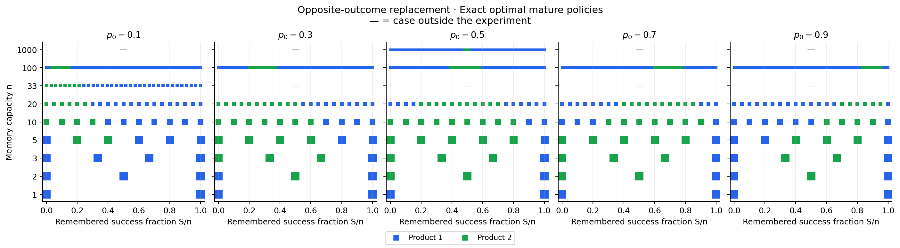
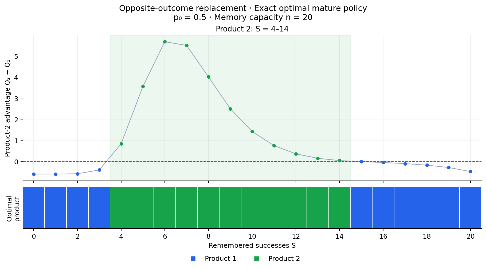
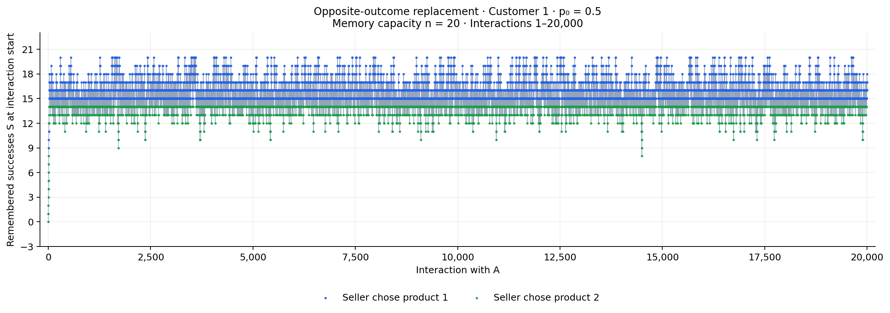
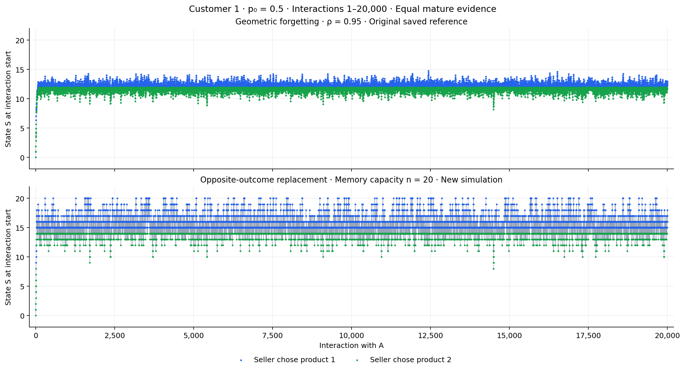
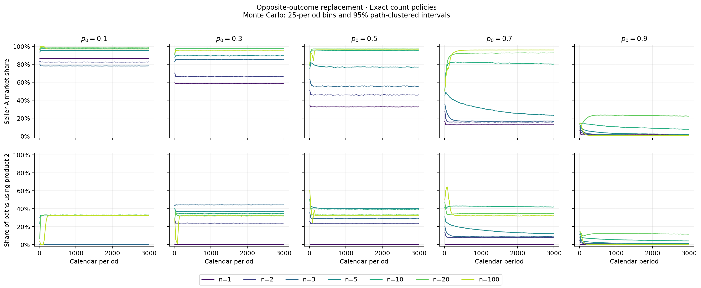

# Resultados: reemplazo del resultado opuesto

Los gráficos activos de `figures/` y los datos de `data/` corresponden al nuevo experimento. La versión FIFO anterior se conserva en `archive/fifo_previous/`.

**Todas las capacidades se resuelven directamente como MDP de conteos, incluida n=1000. No se usan aproximaciones de historias ni interpolación.** Los certificados numéricos y sus tolerancias están en `data/solver_diagnostics.csv`.

## Regla de actualización

El estado es (m,S), con F=m−S. Antes de completar la capacidad, m aumenta en uno y S aumenta sólo si el resultado es éxito. Al completar n resultados:

\[S'=\min(n,S+1)\text{ ante éxito},\qquad S'=\max(0,S-1)\text{ ante fracaso}.\]

El resultado nuevo reemplaza uno del tipo opuesto; si no existe uno, S queda saturado en el borde. Elegir la opción externa no actualiza el estado. n es una capacidad de memoria, no una ventana de los últimos n resultados cronológicos.

Se mantienen c₂=0.65, p₁=0.35, p₂=0.8, c₁=0.05, R=1 y γ=0.98. La equivalencia n≈1/(1−ρ) conserva la capacidad de evidencia y usa redondeo al entero más cercano, con empates hacia arriba.

## Política óptima en madurez

Para p₀=0.5, los intervalos inclusivos de éxitos donde se elige producto 2 son:

| Capacidad n | S donde se elige producto 2 |
|---|---|
| 1 | Ninguno |
| 2 | 0–1 |
| 3 | 0–2 |
| 5 | 0–4 |
| 10 | 0–8 |
| 20 | 4–14 |
| 100 | 39–58 |
| 1000 | 484–512 |

En particular, para **n=20** se elige producto 1 con S=0–3, producto 2 con **S=4–14** y producto 1 con S=15–20. La banda aparece numéricamente en esta calibración; no se impone al solver ni constituye una demostración para todos los parámetros.

Las políticas de los niveles iniciales m<n se resuelven por inducción hacia atrás. Los gráficos de trayectorias e histogramas incluyen esos niveles: un color fuera de la banda madura durante el inicio no indica una inconsistencia.

## Trayectorias y estabilidad

Se simularon 20 consumidores × 20.000 interacciones en cada uno de 11 escenarios. Cada gráfico e histograma usa al consumidor 1, sin promediar estados. Se registra el estado antes de la decisión y el resultado.

En el experimento largo de n=20 y p₀=0.5, con 100 consumidores × 200.000 interacciones y burn-in de 20.000, la frecuencia media del producto 2 es **33.887%** (IC 95% entre consumidores: 33.839%–33.935%). El promedio de éxitos recordados después del burn-in es 15.2212. El intervalo mide incertidumbre Monte Carlo; no certifica estacionariedad ni tiempo de mezcla.

Los paneles de la referencia geométrica y el nuevo modelo no usan trayectorias emparejadas. La referencia original no se modifica.

## Monte Carlo calendario

Se recalcularon **35 escenarios de 20.000 consumidores × 3.000 períodos**, siete capacidades y cinco valores de p₀. En los bloques de 25 períodos, los intervalos al 95% usan al consumidor como clúster. Los mismos uniformes se comparten entre capacidades a igual p₀.

Promedios de los 3.000 períodos para p₀=0.5:

| n | Cuota de A | Producto 2, incondicional | Producto 2 dado A |
|---|---:|---:|---:|
| 1 | 32.61% | 0.00% | 0.00% |
| 2 | 45.91% | 23.14% | 50.40% |
| 3 | 55.77% | 28.80% | 51.65% |
| 5 | 77.17% | 40.16% | 52.04% |
| 10 | 95.25% | 39.52% | 41.49% |
| 20 | 96.90% | 33.13% | 34.18% |
| 100 | 95.71% | 32.40% | 33.86% |

[Tabla completa con intervalos](data/calendar_summary.csv) · [Bandas detectadas, sin imponer umbrales](data/policy_intervals.csv) · [Diagnósticos numéricos](data/solver_diagnostics.csv) · [Auditoría](data/validation.json)

## Reproducción

Código y comandos en [README.md](README.md). Se resolvieron 37 calibraciones exactas; las simulaciones se generaron de nuevo con esta dinámica, no se reclasificaron ni reutilizaron las trayectorias FIFO.
