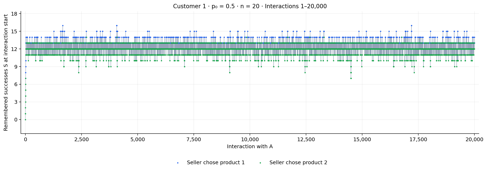
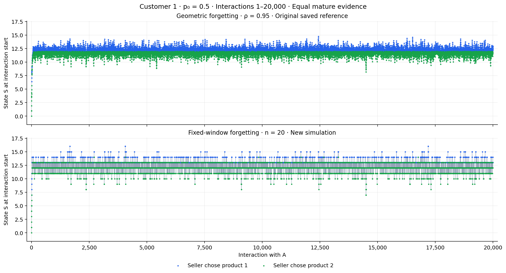
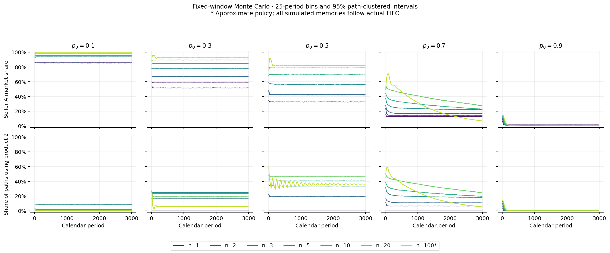

# Resultados: monopolio con ventana fija

Se ejecutaron 35 escenarios de 20.000 consumidores × 3.000 períodos calendario, 11 escenarios de 20 historias × 20.000 interacciones y el diagnóstico de 100 historias × 200.000 interacciones. En todos los casos c₂=0.65 y n es el entero más cercano a 1/(1−ρ).

**Las políticas son soluciones del MDP FIFO completo para n≤20. Las de n=33,100,1000 son aproximadas: las cotas globales en madurez no permiten certificarlas como cercanas a la óptima.** Todos los consumidores simulados, también en esos casos, conservan y expulsan resultados mediante FIFO real.

## Caso principal: p₀=0.5, n=20

Este es el equivalente al gráfico adjunto con ρ=0.95. El solver enumera 1.048.576 historias maduras, además de las historias transitorias. En las cinco calibraciones de p₀, todas las acciones exactas se distinguen de la indiferencia por más que la cota numérica de error.

En el experimento largo, después de las primeras 20.000 interacciones, la frecuencia del producto 2 es **57.841%** (IC 95% entre consumidores: 57.808%–57.873%). El promedio de éxitos recordados es 12.2048. El intervalo describe incertidumbre Monte Carlo; no es una afirmación de estacionariedad o tiempo de mezcla.

La decisión madura no se resume con un único umbral en el conteo S:

| Éxitos S en los 20 resultados | Política exacta |
|---|---|
| 0–3 | Producto 1 en todas las historias |
| 4–6 | Depende del orden de los resultados |
| 7–10 | Producto 2 en todas las historias |
| 11–15 | Depende del orden de los resultados |
| 16–20 | Producto 1 en todas las historias |

Las tablas por S proyectan sobre todos los órdenes posibles, sin ponderarlos por su frecuencia de visita. El mapa de historias completas y las tablas NPZ permiten consultar la acción de cada historia.

Los dos paneles son una comparación descriptiva con la referencia original guardada. Las trayectorias de esa figura no están emparejadas por sus números aleatorios.

## Monte Carlo calendario

Promedios de los 3.000 períodos para p₀=0.5. La última columna condiciona en comprar A; la columna anterior divide por todos los períodos de todos los consumidores.

| n | Demanda de A | Producto 2, incondicional | Producto 2 dado A | Política |
|---|---:|---:|---:|---|
| 1 | 32.61% | 0.00% | 0.00% | Exacta |
| 2 | 42.17% | 18.92% | 44.86% | Exacta |
| 3 | 42.67% | 19.14% | 44.85% | Exacta |
| 5 | 56.57% | 33.60% | 59.39% | Exacta |
| 10 | 69.42% | 41.68% | 60.05% | Exacta |
| 20 | 79.80% | 46.20% | 57.90% | Exacta |
| 100 | 82.28% | 36.37% | 44.20% | Aproximada |

[Tabla completa con intervalos al 95% para los cinco p₀](data/calendar_summary.csv).

## Precisión de las ventanas grandes

Se compararon dos profundidades del planificador sobre historias aleatorias y también historias ordenadas deliberadamente por éxitos antiguos o recientes. El máximo desacuerdo entre resoluciones fue **1.96%** en alguna de las muestras. Esto no acota el error respecto de la política óptima: dos aproximaciones pueden coincidir y compartir sesgo.

Para n=100, p₀=0.5, se ejecutó además un Monte Carlo emparejado de 2.000 consumidores × 1.000 períodos, con memoria FIFO real en ambas resoluciones:

| Diferencia k=12 menos k=10 | Estimación | IC 95% emparejado |
|---|---:|---:|
| Beneficio descontado | -0.008571 | [-0.050295, 0.033153] |
| Cuota de A, en proporción | 0.001761 | [0.001521, 0.002001] |
| Producto 2 incondicional, en proporción | 0.001555 | [0.000991, 0.002119] |

El beneficio no presenta una diferencia estadísticamente distinguible de cero en este contraste. Sí se detectan pequeños cambios en las frecuencias: no se afirma igualdad de las políticas.

Para n=1000, el descuento γ=0.98 hace que los estados maduros reciban muy poco peso al comenzar desde memoria vacía. La pérdida de beneficio descontado desde ese estado inicial queda acotada por **9.73e-06**. Esta garantía inicial no certifica la política después de llenar la ventana.

[Diagnósticos y cotas por escenario](data/solver_diagnostics.csv) · [Historias de validación y refinamientos](data/refinement/state_comparison.csv) · [Auditoría de resultados](data/validation.json)

## Reproducción

Las instrucciones, ecuaciones, semillas y formatos están en [README.md](README.md). Código en `code/`, datos en `data/` y gráficos en `figures/`. El experimento original se conserva sin modificaciones.
