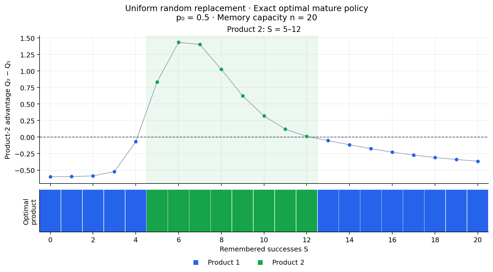
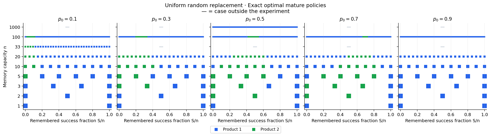
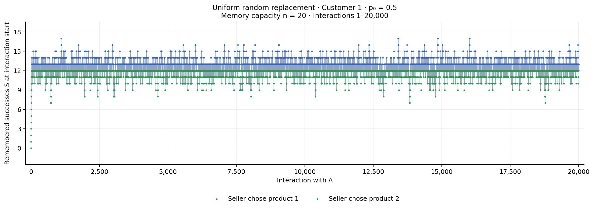
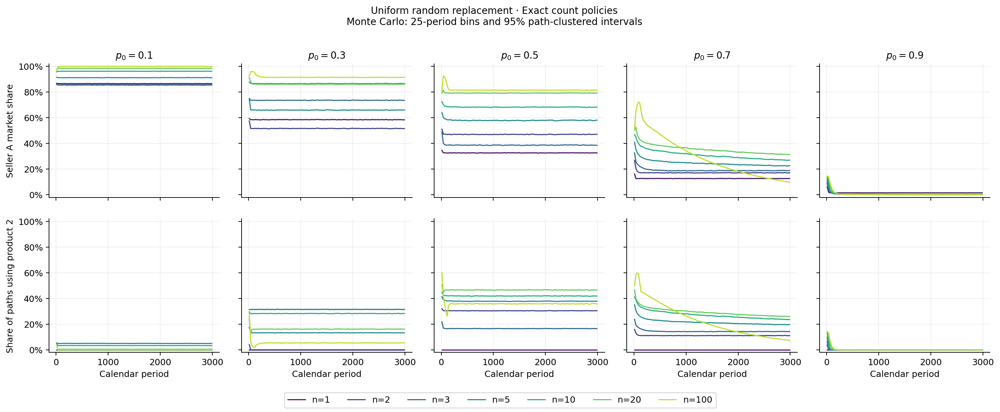
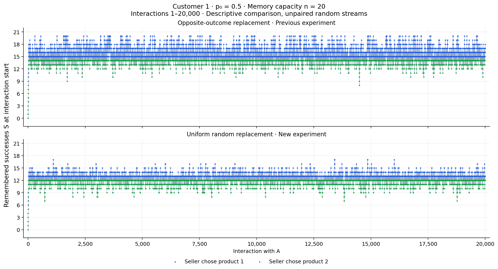
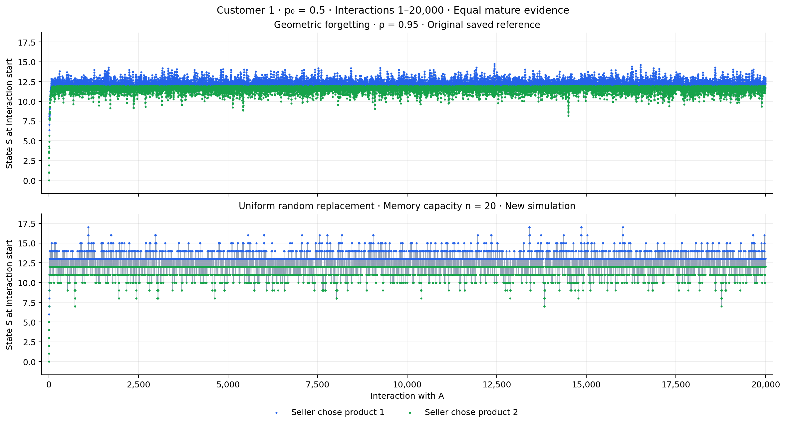

# Experimento nuevo: reemplazo aleatorio uniforme

Este experimento independiente está en `forgetting_random_replacement/`. Los resultados del reemplazo opuesto permanecen en `forgettin_fixed/`.

## Regla

Con la memoria llena se elige uniformemente una de sus n observaciones y se sustituye por el resultado nuevo. El tipo de dato eliminado se sortea independientemente del resultado nuevo:

\[R\sim\operatorname{Bernoulli}(S/n),\quad Y\sim\operatorname{Bernoulli}(p_i),\quad S'=S+Y-R.\]

Por tanto, con n=20 y S=18, un fracaso nuevo deja S=17 con probabilidad 18/20 y S=18 con probabilidad 2/20, exactamente como en el ejemplo solicitado. También puede eliminarse un éxito al llegar otro éxito: S entonces no cambia.

La simulación inicia con memoria **vacía, acumulando hasta n**. Si comienza vacía, se agregan los primeros n resultados sin eliminar ninguno; después la memoria conserva exactamente n observaciones. La opción externa no modifica el estado.

La regla mantiene conteos enteros y no conserva el orden cronológico. En madurez, E[S′|S,i]=(1−1/n)S+pᵢ. Así, para n=20, la retención esperada es 0.95. Esta igualdad de medias no implica las mismas políticas que el forgetting geométrico, pues la demanda y el valor de continuación son no lineales.

## Políticas óptimas

Todas las capacidades se resuelven directamente como MDP finitos de conteos. Se integra el riesgo de reemplazo al calcular Q₁ y Q₂, antes de elegir el producto. No se impone que la política sea una banda; se detectan sus intervalos después de resolver.

Para p₀=0.5, los intervalos inclusivos de S donde se elige producto 2 son:

| n | Producto 2 en madurez |
|---|---|
| 1 | Ningún estado |
| 2 | 0–1 |
| 3 | 0–1 |
| 5 | 0–3 |
| 10 | 1–6 |
| 20 | 5–12 |
| 100 | 42–54 |
| 1000 | Ningún estado |

Para **n=20, p₀=0.5**, la banda es **S=5–12**. El experimento de reemplazo opuesto daba S=4–14: son modelos diferentes.

## Simulaciones

Se recalcularon 35 escenarios calendario: cinco p₀ y siete capacidades, con 20.000 consumidores × 3.000 períodos cada uno. Se guardaron 11 escenarios de 20 historias × 20.000 interacciones y un diagnóstico largo de 100 historias × 200.000 interacciones. Se mantienen c₂=0.65, c₁=0.05, p₁=0.35, p₂=0.8, R=1 y γ=0.98.

Para n=20 y p₀=0.5, después del burn-in de 20.000 interacciones, la frecuencia media de producto 2 es **58.865%** (IC 95% entre consumidores: 58.808%–58.921%). El promedio de éxitos recordados es 12.2979.

Cada histograma utiliza al consumidor 1 e incluye el transiente. Los registros guardan el estado anterior a elegir y el tipo de observación eliminada, de modo que es posible reconstruir todos los estados. Los intervalos Monte Carlo usan al consumidor como clúster y no describen incertidumbre de parámetros ni prueban estacionariedad.

## Comprobación del beneficio descontado

Para n=20,p₀=0.5, el valor de Bellman del estado inicial es **23.19198**. El beneficio Monte Carlo medio es **23.21839**, con IC 95% [23.16022, 23.27656]. La tabla completa permite comprobar esta comparación para cada escenario.

[Resumen calendario con intervalos y beneficios](data/calendar_summary.csv) · [Transiciones condicionadas al resultado nuevo](data/conditional_transitions.csv) · [Diagnósticos](data/solver_diagnostics.csv) · [Auditoría](data/validation.json)

## Comparación descriptiva con los otros modelos

Las trayectorias de modelos distintos no están emparejadas: el modelo aleatorio requiere un sorteo adicional para eliminar la observación. Dentro del experimento nuevo, las capacidades comparten uniformes a igual p₀.

## Reproducción

Se resolvieron 37 calibraciones exactas por conteos. El método, la inicialización y los comandos están documentados en [README.md](README.md).
