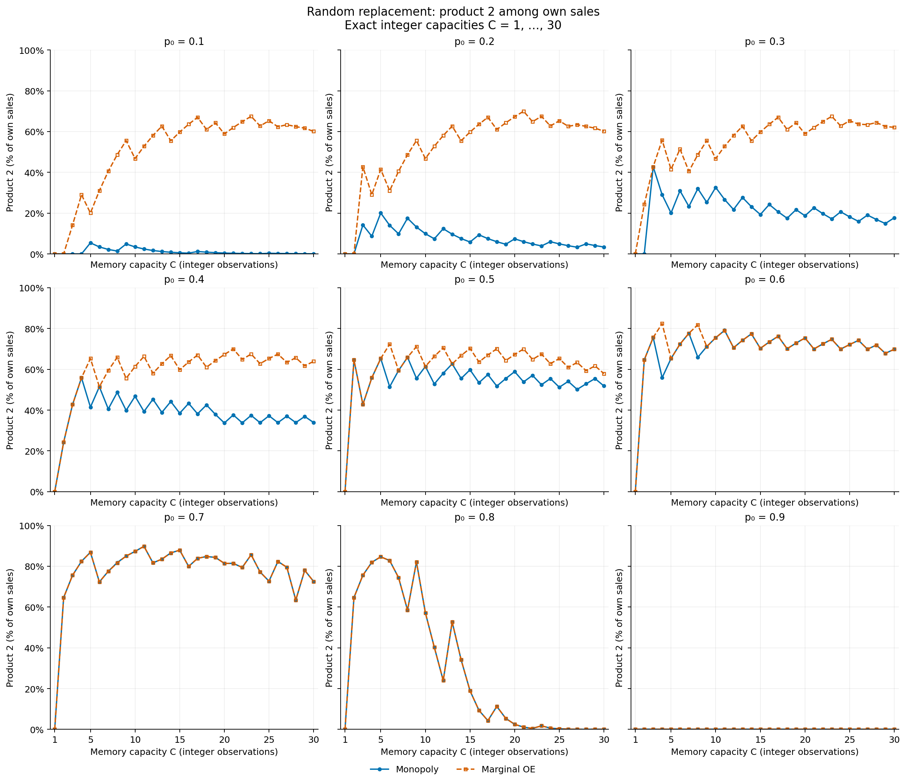
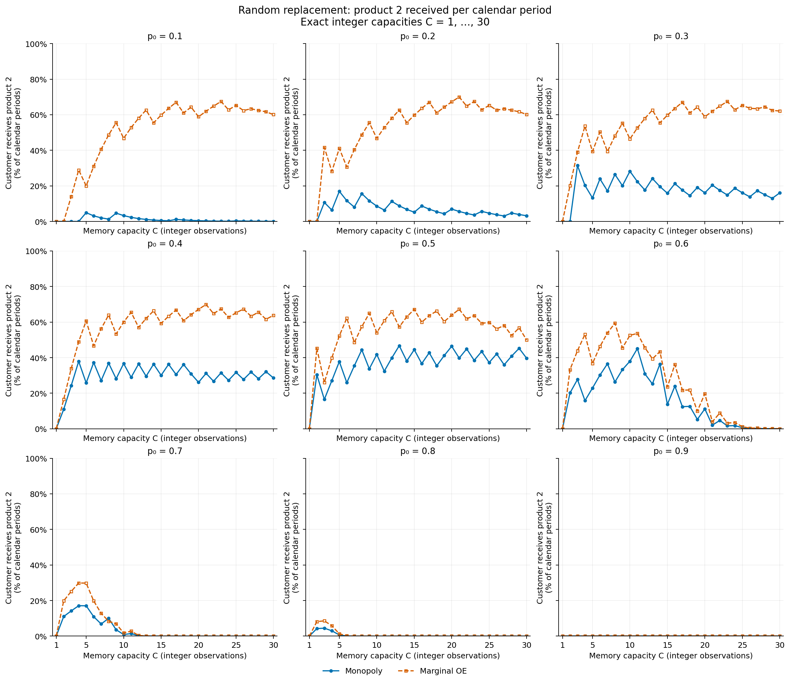
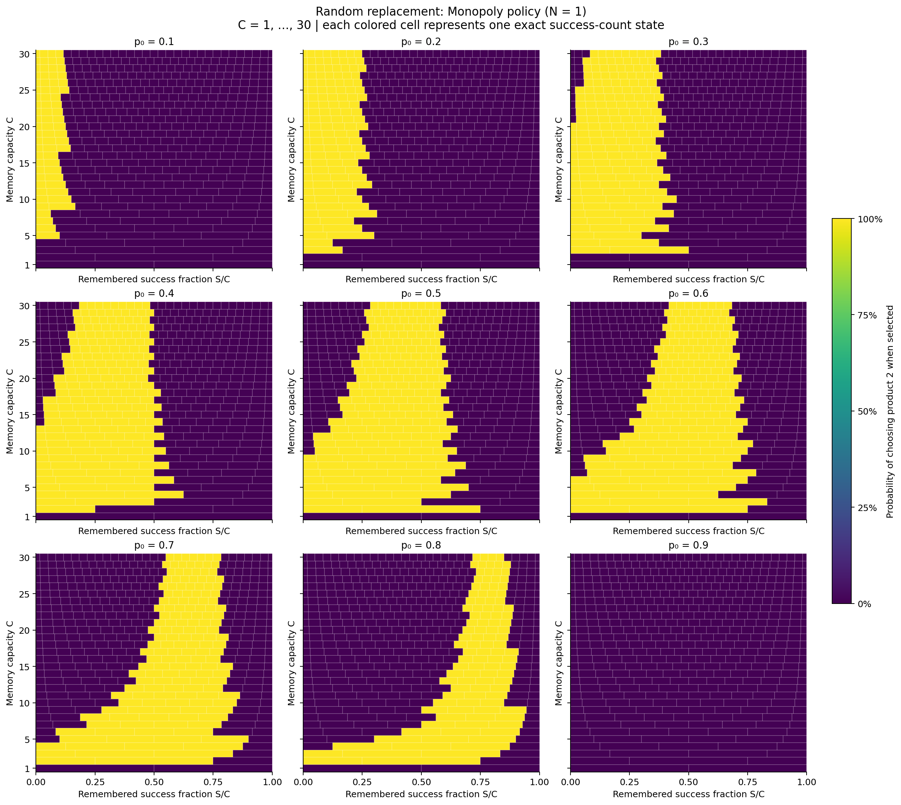
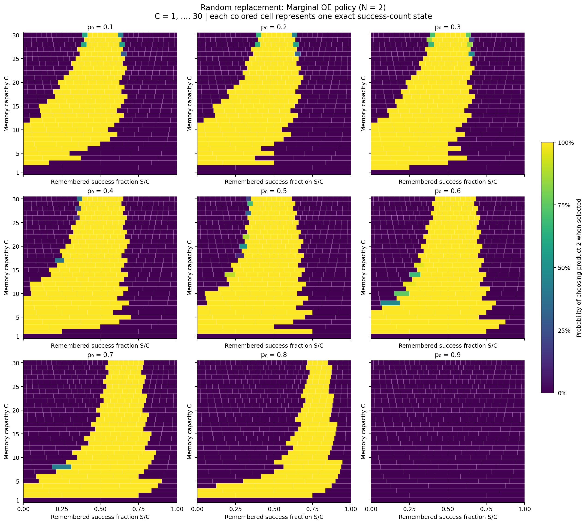
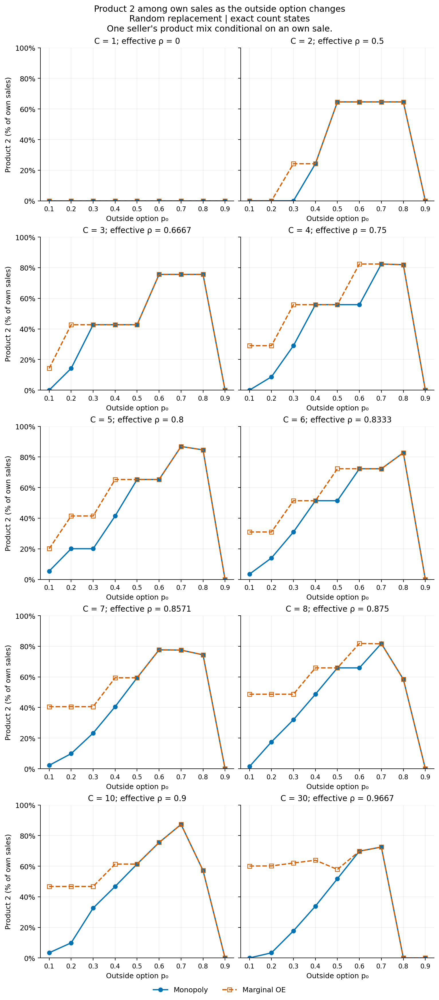
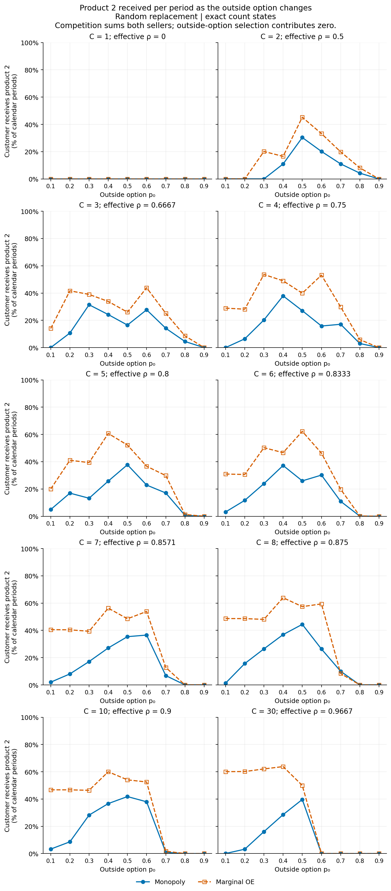
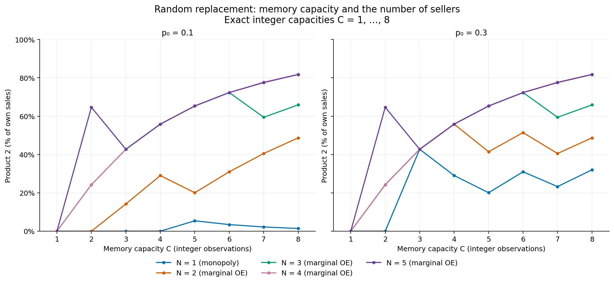

# Integer-capacity campaign results

All **858 distinct cases** passed the saved campaign audit. The primary horizontal variable is the actual integer memory capacity C, covering every value from 1 through 30 without duplicate rho mappings.

The five-seller extension is limited to the certified range `C=1,...,8`. Solver stress tests at larger capacities did not pass the current independent stationary-convergence checks. Those exploratory calculations are excluded from the published results; this does not establish that an equilibrium fails to exist. Details are retained in [exploratory solver checks](data/exploratory_solver_checks.json).

## Experiment 8

The figures compare Monopoly and two-seller Marginal OE at outside options `0.1, 0.2, 0.3, 0.4, 0.5, 0.6, 0.7, 0.8, 0.9`; Conditional OE remains in the numerical tables. Every marker is a separately certified integer-capacity model. Connecting lines guide the eye.

### Why the curves are jagged

Each capacity C is a different finite-memory model, with exact states `S=0,...,C` and posterior `Beta(1+S,1+C-S)`. Changing C changes the state space and replacement probabilities. The product-2 decision is usually pure: an individual count state can enter or leave the product-2 region. The reported share is the sum of product-2 probabilities weighted by the stationary distribution at own sales; both the policy and those weights change.

For monopoly at `p0=.5`, the saved policies give:

| Capacity C | Counts choosing product 2 | Product 2 among own sales |
|---:|---|---:|
| 5 | S = 0–3 | 65.3007% |
| 6 | S = 0–3 | 51.4338% |
| 7 | S = 0–4 | 59.4279% |
| 8 | S = 0–5 | 65.8813% |
| 9 | S = 0–5 | 55.5617% |

C5 and C6 use product 2 at the same counts, S0–S3, but their sale-time weights differ. At C7, count S4 enters the product-2 region. This produces a fall and rebound without any interpolation approximation. These monopoly cases also pass an independent count-MDP comparison; their Bellman residuals are of order 1e-15, far smaller than the changes shown. No smoothness, monotonicity, or concavity in C is imposed or proved.

For the baseline outside option `p0=.5`, selected own-sales product-2 shares are:

| Capacity C | Effective retention | Monopoly | Marginal OE | Conditional OE |
|---:|---:|---:|---:|---:|
| 1 | 0.000000 | 0.0000% | 0.0000% | 0.0000% |
| 2 | 0.500000 | 64.6409% | 64.6409% | 64.6409% |
| 3 | 0.666667 | 42.7349% | 42.7349% | 42.7349% |
| 4 | 0.750000 | 55.8375% | 55.8375% | 55.8375% |
| 5 | 0.800000 | 65.3007% | 65.3007% | 65.3007% |
| 6 | 0.833333 | 51.4338% | 72.3293% | 72.3293% |
| 7 | 0.857143 | 59.4279% | 59.4279% | 59.4279% |
| 8 | 0.875000 | 65.8813% | 65.8797% | 65.8797% |
| 10 | 0.900000 | 61.3864% | 61.3864% | 61.3864% |
| 15 | 0.933333 | 59.7650% | 70.2716% | 70.2716% |
| 20 | 0.950000 | 58.8629% | 67.2656% | 67.2634% |
| 25 | 0.960000 | 51.2045% | 65.2998% | 65.2998% |
| 30 | 0.966667 | 51.8101% | 57.8795% | 63.9099% |

## Optimal product policies

Each map shows all C1 through C30 and all 9 outside options. Color is the probability of choosing product 2 conditional on being selected, at the seller's own retained success count S. Zero and one are pure product choices; intermediate colors represent mixed choices. Each cell represents an exact count state, with edges halfway between neighboring S/C values. This is a policy map, not a stationary frequency plot.

Success-count versions: [Monopoly](figures/policies/10_monopoly_policy_by_capacity_success_counts.pdf) and [Marginal OE](figures/policies/11_oblivious_policy_by_capacity_success_counts.pdf). These maps use integer successes S horizontally. Each unit cell is one state; gray S > C is infeasible. Both views display the same saved action probabilities.

[Side-by-side policies at p0=.5](figures/policies/01_policy_comparison_p0_0p5.pdf)

The comparison panels use C1, C2, C3, C4, C5, C6, C7, C8, C10, C30. Every marker is an exact count state; connecting lines guide the eye. Both models are shown together, with Conditional OE excluded. Comparisons at each outside option:

- p0 = 0.1: [fraction S/C](figures/policies/01_policy_comparison_p0_0p1.pdf) | [success count S](figures/policies/01_policy_comparison_p0_0p1_success_counts.pdf).
- p0 = 0.2: [fraction S/C](figures/policies/01_policy_comparison_p0_0p2.pdf) | [success count S](figures/policies/01_policy_comparison_p0_0p2_success_counts.pdf).
- p0 = 0.3: [fraction S/C](figures/policies/01_policy_comparison_p0_0p3.pdf) | [success count S](figures/policies/01_policy_comparison_p0_0p3_success_counts.pdf).
- p0 = 0.4: [fraction S/C](figures/policies/01_policy_comparison_p0_0p4.pdf) | [success count S](figures/policies/01_policy_comparison_p0_0p4_success_counts.pdf).
- p0 = 0.5: [fraction S/C](figures/policies/01_policy_comparison_p0_0p5.pdf) | [success count S](figures/policies/01_policy_comparison_p0_0p5_success_counts.pdf).
- p0 = 0.6: [fraction S/C](figures/policies/01_policy_comparison_p0_0p6.pdf) | [success count S](figures/policies/01_policy_comparison_p0_0p6_success_counts.pdf).
- p0 = 0.7: [fraction S/C](figures/policies/01_policy_comparison_p0_0p7.pdf) | [success count S](figures/policies/01_policy_comparison_p0_0p7_success_counts.pdf).
- p0 = 0.8: [fraction S/C](figures/policies/01_policy_comparison_p0_0p8.pdf) | [success count S](figures/policies/01_policy_comparison_p0_0p8_success_counts.pdf).
- p0 = 0.9: [fraction S/C](figures/policies/01_policy_comparison_p0_0p9.pdf) | [success count S](figures/policies/01_policy_comparison_p0_0p9_success_counts.pdf).

[Adjacent-capacity policies at p0=.5](figures/policies/02_adjacent_capacities_C5_C6_C7_p0_0p5.pdf)

[Adjacent-capacity policies using success counts](figures/policies/02_adjacent_capacities_C5_C6_C7_p0_0p5_success_counts.pdf)

Success-count panels use separate integer axes S = 0,...,C, with failures F = C-S. Fraction panels retain the shared S/C scale. The ten-capacity comparisons use five rows and two columns in both representations.

In monopoly, C5 and C6 choose product 2 at S0–S3; C7 also chooses it at S4. The stationary weights still differ between C5 and C6 even though these sets of counts coincide. All 540 policies and 8,910 count-state actions are exported in [policy figure data](data/policy_figure_data.csv), with checkpoint hashes in the [policy figure manifest](data/policy_figure_manifest.json).

## Outside-option comparisons

The 10 panels use C1, C2, C3, C4, C5, C6, C7, C8, C10, C30. Own-sales product mix and customer calendar receipt have different denominators. The latter sums both sellers in competition and counts outside-option selection as zero receipt.

## Seller-count comparisons

The capacity-sweep seller extension uses marginal OE for N2 through N5 and the monopoly solution for N1, at both low outside options. Every capacity in `C=1,...,8` is solved for all five seller counts. The following table reports own-sales product-2 shares at the capacities highlighted in the seller-count figure:

| Capacity | Outside option | 1 seller | 2 sellers | 3 sellers | 4 sellers | 5 sellers |
|---:|---:|---:|---:|---:|---:|---:|
| 1 | 0.1 | 0.0000% | 0.0000% | 0.0000% | 0.0000% | 0.0000% |
| 1 | 0.3 | 0.0000% | 0.0000% | 0.0000% | 0.0000% | 0.0000% |
| 3 | 0.1 | 0.0000% | 14.2099% | 42.7349% | 42.7349% | 42.7349% |
| 3 | 0.3 | 42.7349% | 42.7349% | 42.7349% | 42.7349% | 42.7349% |
| 5 | 0.1 | 5.4307% | 20.0678% | 65.3007% | 65.3007% | 65.3007% |
| 5 | 0.3 | 20.0678% | 41.4519% | 65.3007% | 65.3007% | 65.3007% |
| 8 | 0.1 | 1.4195% | 48.6828% | 65.8797% | 81.8089% | 81.7271% |
| 8 | 0.3 | 32.0116% | 48.6828% | 65.8797% | 81.8089% | 81.7318% |

Calendar sales, profit, and outside-option choice can differ even when own-sales product mix is equal. The complete correlated joint law and each model's actual discounted payoff remain available in its NPZ checkpoint.

## Validation

The audit accepted 858/858 cases. The maximum additional figure-accounting residual is 3.775e-15.

| Reconstructed check | Worst error |
|---|---:|
| actual value | 2.132e-14 |
| advantage | 4.774e-15 |
| belief relative | 1.887e-15 |
| bellman | 2.132e-14 |
| calendar flow l1 | 2.841e-16 |
| conditional regret | 1.042e-10 |
| fresh conditional jump l1 | 3.027e-16 |
| fresh conditional law l1 | 3.032e-15 |
| full conditional rival row l1 | 4.443e-15 |
| jump stationary l1 | 5.241e-15 |
| market partition | 3.775e-15 |
| metric relative | 8.923e-16 |
| sale law l1 | 4.938e-15 |

[Full validation](data/validation.json), [all summary rows](data/summary.csv), [plotted values](data/figure_data.csv), and [publication hashes](figures/manifest.json). See [README.md](README.md) for definitions, initialization, and reproduction.
