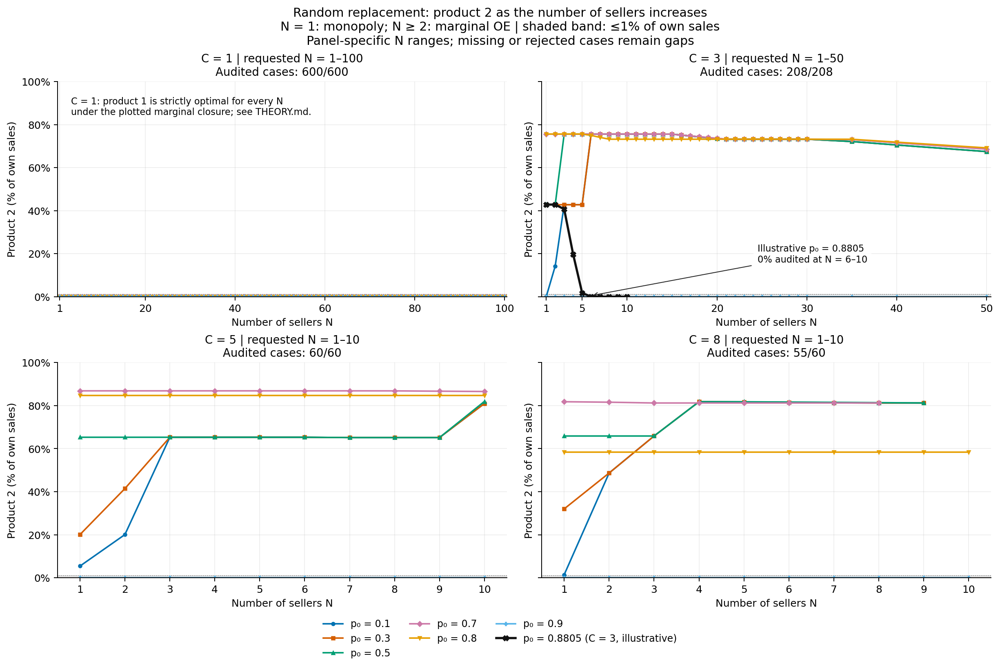
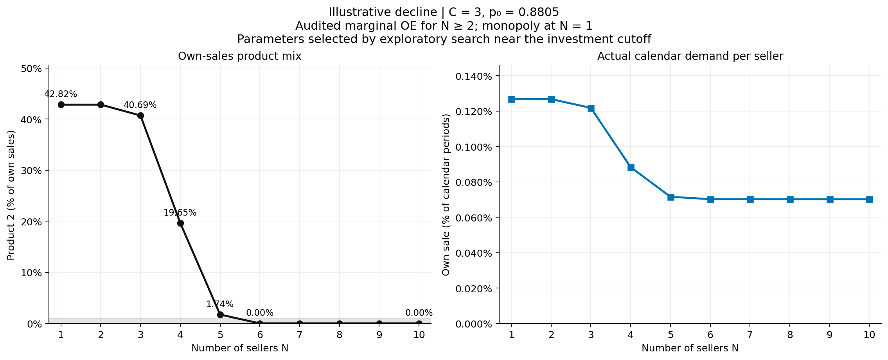

# Extended seller-count observations

The available-case audit passed for 923/928 requested cases. The remaining 5 cases are not published as results; see data/validation.json for missing or failed cases. A passing available-case audit is not complete requested coverage.

The table reports the last audited value, rather than substituting zero for unavailable endpoints. A crossing is the first audited point at or below 1% after an earlier audited point above 1%; it does not imply all subsequent seller counts stay in that band. The complete CSV also records the beginning of any verified terminal run in the near-zero band.

| C | p₀ | Requested max N | Last audited N | Product 2 at last N | Smallest positive share | First ≤1% after >1% |
|---:|---:|---:|---:|---:|---:|---:|
| 1 | 0.1 | 100 | 100 | 0.0000% | — | — |
| 1 | 0.3 | 100 | 100 | 0.0000% | — | — |
| 1 | 0.5 | 100 | 100 | 0.0000% | — | — |
| 1 | 0.7 | 100 | 100 | 0.0000% | — | — |
| 1 | 0.8 | 100 | 100 | 0.0000% | — | — |
| 1 | 0.9 | 100 | 100 | 0.0000% | — | — |
| 3 | 0.1 | 50 | 50 | 67.4405% | 14.21% | — |
| 3 | 0.3 | 50 | 50 | 67.4405% | 42.73% | — |
| 3 | 0.5 | 50 | 50 | 67.4432% | 42.73% | — |
| 3 | 0.7 | 50 | 50 | 68.5822% | 68.58% | — |
| 3 | 0.8 | 50 | 50 | 69.1661% | 69.17% | — |
| 3 | 0.9 | 50 | 50 | 0.0000% | — | — |
| 5 | 0.1 | 10 | 10 | 80.9650% | 5.431% | — |
| 5 | 0.3 | 10 | 10 | 80.9674% | 20.07% | — |
| 5 | 0.5 | 10 | 10 | 81.9368% | 65.15% | — |
| 5 | 0.7 | 10 | 10 | 86.5631% | 86.56% | — |
| 5 | 0.8 | 10 | 10 | 84.6295% | 84.63% | — |
| 5 | 0.9 | 10 | 10 | 0.0000% | — | — |
| 8 | 0.1 | 10 | 9 | 81.2242% | 1.42% | — |
| 8 | 0.3 | 10 | 9 | 81.2242% | 32.01% | — |
| 8 | 0.5 | 10 | 9 | 81.2429% | 65.88% | — |
| 8 | 0.7 | 10 | 8 | 81.2242% | 81.22% | — |
| 8 | 0.8 | 10 | 10 | 58.4538% | 58.45% | — |
| 8 | 0.9 | 10 | 10 | 0.0000% | — | — |
| 3 | 0.8805 | 10 | 10 | 0.0000% | 1.738% | 6 |

## An audited positive-to-zero example

The additional `C=3, p0=0.8805` curve was selected after an exploratory search near the investment cutoff. It is an illustrative example, not a pre-specified broad-grid finding or a general claim across p0. It displays a verified equilibrium branch; uniqueness is not established.

| Sellers N | Product 2 among own sales | Actual own sale per calendar period |
|---:|---:|---:|
| 1 | 42.8187% | 0.12683% |
| 2 | 42.8187% | 0.12672% |
| 3 | 40.6905% | 0.12177% |
| 4 | 19.6502% | 0.08827% |
| 5 | 1.7382% | 0.07152% |
| 6 | 0.0000% | 0.07020% |
| 7 | 0.0000% | 0.07017% |
| 8 | 0.0000% | 0.07015% |
| 9 | 0.0000% | 0.07012% |
| 10 | 0.0000% | 0.07009% |

Product-2 use is positive initially and is exactly zero in the saved policy for N6–10. Actual demand is `sale_rate`: the probability that one seller makes a sale in a calendar period, evaluated under the actual correlated joint law. It differs from own-sales product mix and from the perceived OE demand at a particular reputation. Both demand and policy change in this equilibrium comparison; the right panel is not a controlled causal estimate.

C=1 is separate: under the plotted marginal closure and this calibration, product 1 is strictly optimal for every seller count. Its zero line is not evidence of a decline from a positive share.

For each fixed C, a uniform selection-probability bound proves eventual product-1 dominance for sufficiently large N. The generic sufficient bounds are very conservative: 5,000 for C1, 400 million for C3, 90 trillion for C5, and 3×10²² for C8. These are not predicted or observed crossing points. See [THEORY.md](THEORY.md) for the derivation and the stronger C1 result.

Finite points do not establish monotonicity or identify an asymptotic limit. Own-sales product mix, per-seller calendar flow, and total market receipt are different quantities.

## Numerical verification

Audit of available cases: 923 accepted. Requested coverage: 923/928.

| Reconstructed check | Worst error |
|---|---:|
| actual value | 9.799e-12 |
| advantage | 3.164e-15 |
| belief relative | 1.233e-14 |
| bellman | 1.421e-14 |
| calendar flow l1 | 7.178e-14 |
| conditional regret | 8.218e-12 |
| fresh conditional jump l1 | 0.000e+00 |
| fresh conditional law l1 | 0.000e+00 |
| full conditional rival row l1 | 0.000e+00 |
| jump stationary l1 | 1.709e-13 |
| market partition | 1.066e-14 |
| metric relative | 1.174e-14 |
| sale law l1 | 3.790e-13 |

[All near-zero summaries](data/near_zero_summary.csv), [plotted values and gaps](data/figure_data.csv), [case audit](data/validation.json), and [reproduction](README.md).
