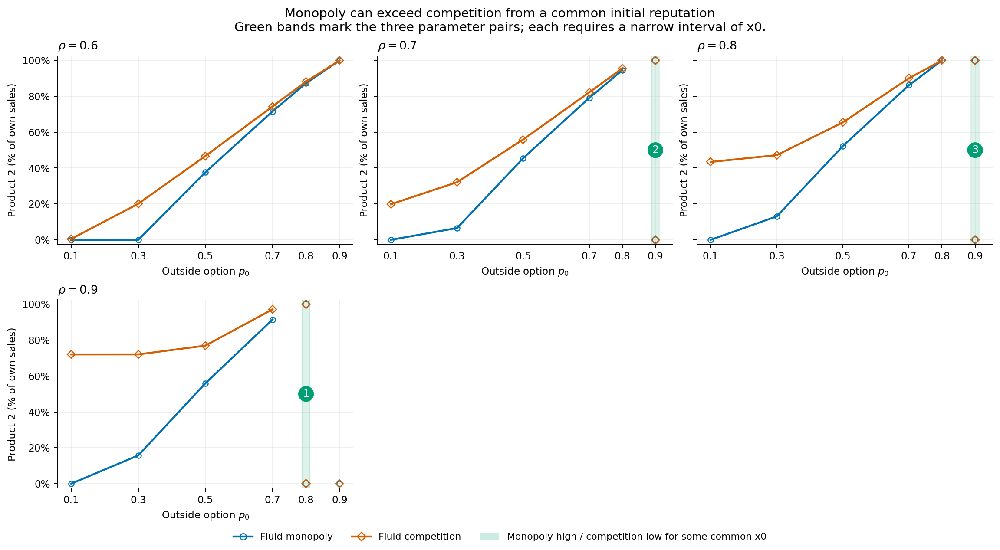

# Casos donde monopolio termina por encima de competencia

Se revisaron las **24 combinaciones activas** y las **27 políticas competitivas verificadas** del experimento 10.

Se compara el mismo inicio: monopolio parte de `x0` y ambos vendedores competitivos parten de `(x0,x0)`. Arriba/abajo se refiere al porcentaje de producto 2 entre las ventas propias en el largo plazo. Los destinos se calculan mediante la línea de fase, sin inferirlos de una simulación de duración finita.

## Tres casos con competencia que confirma el equilibrio bajo

En todos, monopolio converge a `0.8` y usa 100% producto 2; competencia converge a su conjetura `0.35` y usa 0%. No se encontraron otros casos, incluidas las comparaciones con equilibrios mixtos.

| Marca en el gráfico | p0 | rho | condiciones iniciales, políticas guardadas de 4001 nodos |
| --- | --- | --- | --- |
| 1 | 0.8 | 0.9 | (0.530078188901, 0.530115762309] |
| 2 | 0.9 | 0.7 | (0.463936339029, 0.464244581071] |
| 3 | 0.9 | 0.8 | (0.645760399491, 0.645796590289] |

Los extremos siguen la convención guardada: producto 1 y continuación hacia la región baja en el umbral repulsivo. Las fronteras son aproximaciones numéricas.

[PDF del gráfico señalado](figures/16_monopoly_above_competition/01_highlighted_cases.pdf). Los gráficos históricos originales se conservan.

## Comprobación en mallas más finas

Las diferencias de umbrales son pequeñas. Se vuelve a resolver monopolio y la respuesta competitiva al rival `0.35`, con la misma malla para ambos. La demanda coincide con el cálculo original y se contrasta duplicando la cuadratura.

| p0 | rho | nodos de la malla final | intervalo refinado de x0 | ejemplo comprobado en las tres mallas más finas |
| --- | --- | --- | --- | --- |
| 0.8 | 0.9 | 128001 | (0.5301302254, 0.5301630596] | 0.5301430828 |
| 0.9 | 0.7 | 128001 | (0.4639337361, 0.4642932546] | 0.4641127110 |
| 0.9 | 0.8 | 128001 | (0.6457432249, 0.6457997083] | 0.6457712344 |

El refinamiento confirma la existencia numérica de los tres intervalos. Sus ubicaciones cambian con la malla; los intervalos más estrechos requieren usar los valores refinados. Los cambios entre mallas son indicadores de sensibilidad y no cotas matemáticas certificadas.

## Trayectorias bajo políticas antiguas que no confirman su conjetura

La condición antigua también conserva políticas cuya aplicación desde ciertos inicios acaba en otra reputación. Si se cuentan esas trayectorias, hay cuatro combinaciones, con intervalos más amplios. Estas filas no representan un equilibrio competitivo alcanzado desde esos inicios.

| p0 | rho | conjetura competitiva usada | condiciones iniciales, malla guardada de 4001 nodos | producto 2 monopolio | producto 2 competencia |
| --- | --- | --- | --- | --- | --- |
| 0.7 | 0.9 | 0.787226768 | [0, 0.420713457523] | 91.4439% | 0.0000% |
| 0.8 | 0.9 | 0.800000000 | (0.530078188901, 0.572249543346] | 100.0000% | 0.0000% |
| 0.9 | 0.7 | 0.800000000 | (0.463936339029, 0.485527168856] | 100.0000% | 0.0000% |
| 0.9 | 0.8 | 0.800000000 | (0.645760399491, 0.664455417443] | 100.0000% | 0.0000% |

Con el inicio original `x0=0.5`, ninguno de los tres casos con equilibrio competitivo bajo produce la inversión: `(p0,rho)=(0.8,0.9)` y `(0.9,0.8)` terminan abajo en ambos modelos, mientras `(0.9,0.7)` termina arriba en ambos.

Datos completos y procedencia: [data/monopoly_above_competition/](data/monopoly_above_competition/summary.json).
