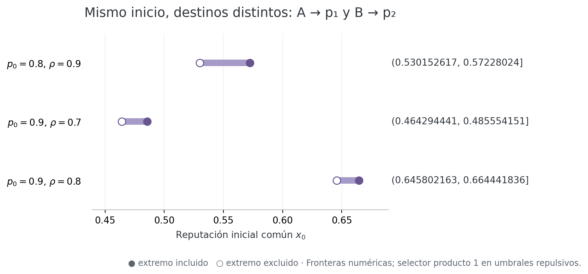
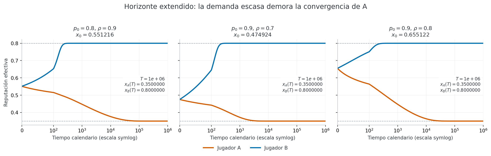
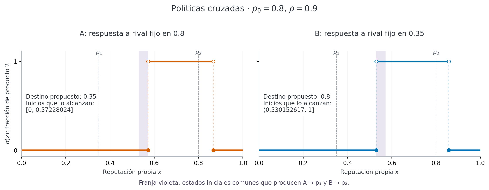
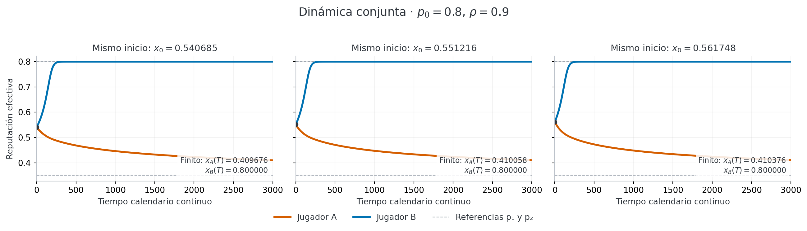
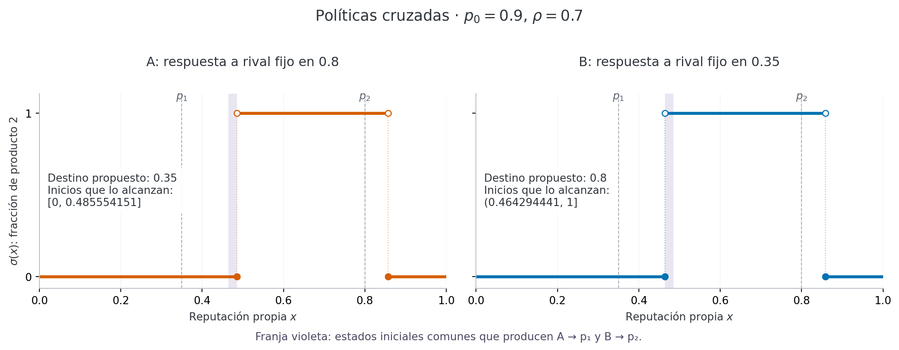
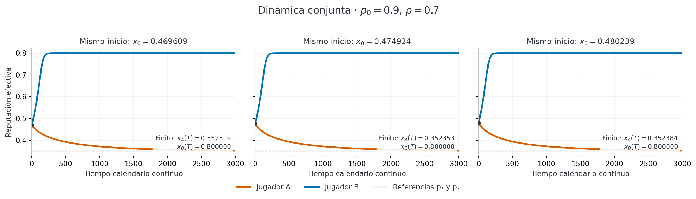
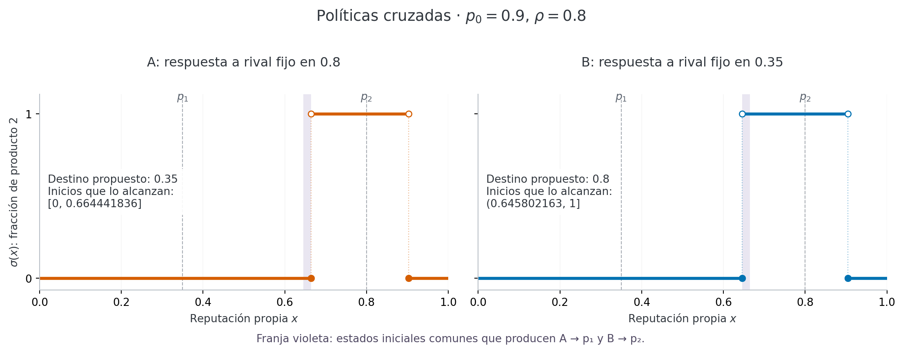
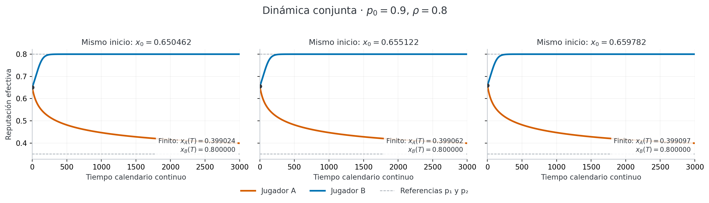
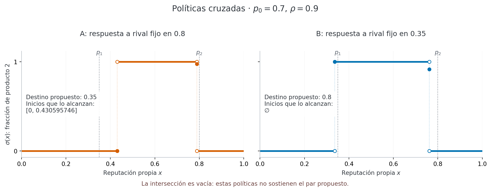
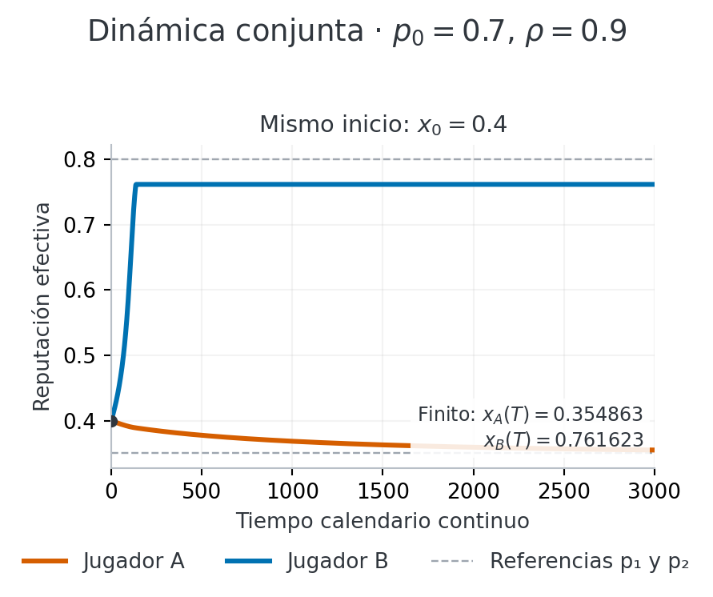

# Prueba de equilibrios fluid oblivious asimétricos

La propuesta se sostiene numéricamente en **3 de los 4 casos examinados**: partiendo del mismo estado inicial, A puede converger a `p1=0.35` y B a `p2=0.8` con políticas distintas calculadas contra la reputación final del otro.

## Respuestas cruzadas y estados iniciales comunes

A optimiza suponiendo que B está fijo en `p2`; B optimiza suponiendo que A está fijo en `p1`. La intersección de los conjuntos de inicios que llevan a los destinos propuestos da el intervalo común.

| p0 | rho | A alcanza p1 | B alcanza p2 | Mismo x0: A → p1, B → p2 | Resultado |
| --- | --- | --- | --- | --- | --- |
| 0.8 | 0.9 | [0, 0.57228024] | (0.530152617, 1] | (0.530152617, 0.57228024] | Verificado |
| 0.9 | 0.7 | [0, 0.485554151] | (0.464294441, 1] | (0.464294441, 0.485554151] | Verificado |
| 0.9 | 0.8 | [0, 0.664441836] | (0.645802163, 1] | (0.645802163, 0.664441836] | Verificado |
| 0.7 | 0.9 | [0, 0.430595746] | ∅ | ∅ | No sostiene este par |

Los tres intervalos positivos coinciden, a la precisión mostrada, con los huecos entre las ramas simétricas puras de la [comprobación del experimento 11](../11_fluid_oblivious_initial_conditions/EXISTENCE_CHECK.md). Permitir políticas distintas para A y B cubre esos inicios que el análisis simétrico dejaba sin cubrir.

Al intercambiar las identidades A y B se obtiene el perfil reflejado, con los mismos inicios comunes.

## Dinámicas con ambas reputaciones efectivas

Las políticas se mantienen fijas durante cada simulación. La demanda se recalcula con `D_A(x_A(t),x_B(t))` y `D_B(x_A(t),x_B(t))`; no se congela al rival en la dinámica realizada. La tabla distingue el estado al horizonte finito del destino asintótico, que procede de la línea de fase.

| p0 | rho | x0 común | T | xA(T) | xB(T) | Límites de A y B |
| --- | --- | --- | --- | --- | --- | --- |
| 0.8 | 0.9 | 0.551216429 | 3000 | 0.410057565 | 0.8 | 0.35, 0.8 |
| 0.9 | 0.7 | 0.474924296 | 3000 | 0.352352898 | 0.8 | 0.35, 0.8 |
| 0.9 | 0.8 | 0.655122 | 3000 | 0.399061583 | 0.8 | 0.35, 0.8 |
| 0.7 | 0.9 | 0.4 | 3000 | 0.35486316 | 0.761623251 | 0.35, 0.761623251 |

## Convergencia en un horizonte extendido

La demanda del vendedor de reputación baja puede ser muy pequeña. Por ello, el estado de A al tiempo `T=3000` puede seguir lejos de `p1`, aunque su límite sea `p1`. Se integró también hasta el horizonte indicado con coordenadas de logaritmo de la distancia al destino y se contrastó el tramo común con la integración original.

| p0 | rho | T extendido | xA(T) | xB(T) | Mayor distancia al destino | Discrepancia en tramo común | Control |
| --- | --- | --- | --- | --- | --- | --- | --- |
| 0.8 | 0.9 | 1e+06 | 0.35 | 0.8 | 0 | 7.82e-11 | Pasa |
| 0.9 | 0.7 | 1e+06 | 0.35 | 0.8 | 0 | 1.18e-10 | Pasa |
| 0.9 | 0.8 | 1e+06 | 0.35 | 0.8 | 0 | 6.71e-12 | Pasa |

### p0=0.8, rho=0.9

### p0=0.9, rho=0.7

### p0=0.9, rho=0.8

### p0=0.7, rho=0.9

El destino propuesto falla para B: la respuesta optimizada no sostiene esa reputación como estado estacionario.

## Verificación y alcance

| p0 | rho | Cambio de frontera/raíz, dos mallas más finas | Mayor residuo HJB | Mayor cambio de demanda | Cambio al refinar integración | Controles numéricos |
| --- | --- | --- | --- | --- | --- | --- |
| 0.8 | 0.9 | 2.7e-05 | 2.45e-12 | 4.63e-14 | 5.05e-12 | Pasan |
| 0.9 | 0.7 | 5.04e-05 | 8.27e-13 | 1.42e-14 | 4.85e-12 | Pasan |
| 0.9 | 0.8 | 1e-05 | 7.47e-13 | 1.77e-14 | 4.16e-12 | Pasan |
| 0.7 | 0.9 | 6.59e-05 | 3.4e-12 | 9.76e-14 | 1.08e-09 | Pasan |

Los HJB se resuelven de nuevo para las dos conjeturas cruzadas. Se comprueban la acción óptima en cada destino, el valor de mantenerlo, el residuo de Bellman, la sensibilidad a la malla y las integraciones conjuntas. Los datos completos están en [results.json](data/results.json), [resumen de casos](data/summary.csv) y [trayectorias](data/trajectories.csv).

La conclusión corresponde al concepto **oblivious con conjetura fija del rival** empleado en los experimentos 10 y 11. No demuestra que estas políticas sean mejores respuestas frente a toda la trayectoria transitoria del rival ni que formen un equilibrio de Nash del juego dinámico completo.

La demanda de cada vendedor es positiva en el dominio compacto de estados de esta calibración. Por tanto, multiplicar la dinámica propia por la demanda efectiva cambia la velocidad, pero conserva la dirección y el destino asintótico de cada política. Esto permite calcular el conjunto completo de inicios comunes mediante la intersección de las dos líneas de fase.

Las fronteras de los intervalos son aproximaciones numéricas. En umbrales repulsivos se elige producto 1 y su continuación inmediata; los extremos abiertos/cerrados corresponden a ese selector. El refinamiento mide sensibilidad numérica, sin constituir una cota rigurosa del error continuo. Esta prueba del par `(p1,p2)` no enumera todos los posibles equilibrios asimétricos.
